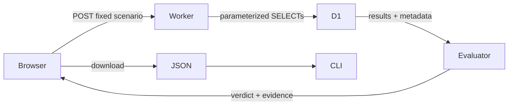

# Architecture and decisions

A single TypeScript Worker serves a small, fixed measurement API. Static assets are served directly by Cloudflare; only `/api/*` routes invoke the Worker. No frontend framework, account system or external analytics service is required.

## The experiment

Two tables have identical seeded rows and integer primary keys. `orders_indexed` additionally has `(merchant_id, created_at DESC, order_id DESC)`. `orders_unindexed` lacks that secondary index. Both copies are already present; visitor requests never create or remove indexes.

The query returns merchant 1's 20 most recent orders. Explicit ID ordering breaks timestamp ties. The baseline must match the expected synthetic records; a broken baseline cannot pass merely by matching a broken candidate.

The wrong-result scenario changes the limit to 1. This deliberately produces fewer reads and incomplete output, illustrating the independent correctness requirement.

## Decision policy

Validate the report contract and read-only metadata first. If invalid, return error. Then compare full ordered results; unequal results fail. Finally, compare candidate reads with the 100-row limit. The before/after ratio is explanatory, not a second policy threshold. The boundary itself passes. A query can increase reads while remaining within budget.

The 100-row budget is specific to the fixture, chosen after observing 20 baseline reads. It is not a pricing limit. `EXPLAIN QUERY PLAN` text is shown, not parsed into a pass/fail rule; SQLite warns that the format can change.

The evaluator is pure TypeScript used by the Worker and CLI. Tests ignore exported verdict flags, exercise wrong values with equal row counts, and reject incorrect baseline results. CLI reports are bounded to 256 KB. This release intentionally validates the known demo contract, not arbitrary schemas or policies.

## Endpoint boundaries

Only a known `scenario` query parameter is accepted on a bodyless POST. Unknown/duplicate parameters, bodies, unsupported methods and cross-origin browser requests are rejected before D1 work. An empty streamed body is allowed: deployed Workers can expose an empty stream even when no payload was sent. This behavior has a regression test.

The endpoint executes five SELECT/EXPLAIN statements in one batch, including a fixture manifest read. Invalid provider responses become a generic 503 without stack traces or configuration details. Zero or missing result data is never converted into a successful cheap query.

A single Cloudflare rate-limit binding allows 12 runs/minute per location using a shared key. This is deliberately simple, can throttle different visitors together, and is approximate. It is neither a global quota nor an accurate accounting mechanism. No IPs are stored. Cloudflare's Free-plan limits remain shared with other account workloads.

## Evidence and CI

Live UI runs are remote D1 responses. Recorded examples keep their original timestamps and deployment versions. The report includes complete result arrays for independent checking. The CLI does not trust embedded decisions but cannot establish the authenticity of edited counters.

Offline GitHub CI checks the evaluator, request boundaries, captured reports and Worker build. It cannot detect a new arbitrary repository SQL regression until a future remote measurement integration is built.

## Rejected scope

No LLM index recommendations, automatic schema modification, generic SQL editor, database credential collection, production monitoring, usage-based dollars projection, or ORM interception. These would obscure the small, verifiable experiment and require additional trust boundaries.

Sources: [D1 metadata](https://developers.cloudflare.com/d1/worker-api/return-object/), [index tradeoffs](https://developers.cloudflare.com/d1/best-practices/use-indexes/), [SQLite plan format](https://www.sqlite.org/eqp.html), [rate-limiter locality](https://developers.cloudflare.com/workers/runtime-apis/bindings/rate-limit/).
