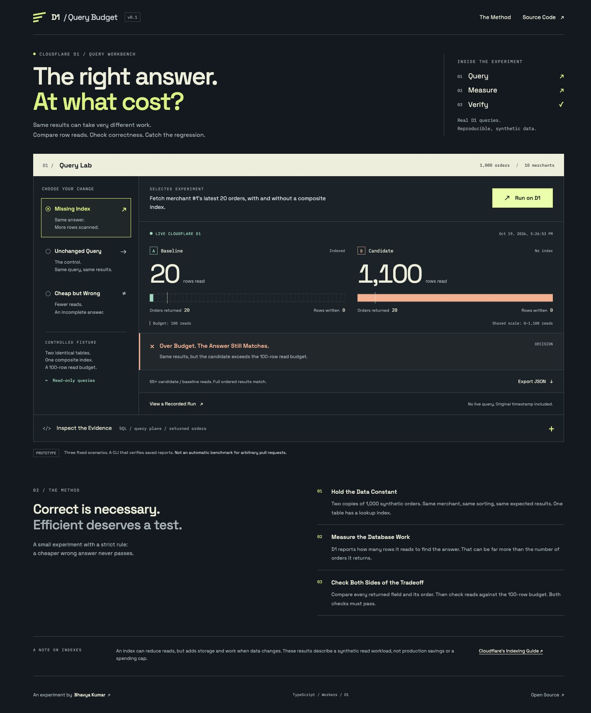

# Frontend review — October 19, 2026

Applied the user-provided frontend-design guidance, ECC frontend-design-direction and frontend-a11y skills, and the [current Vercel Web Interface Guidelines](https://raw.githubusercontent.com/vercel-labs/web-interface-guidelines/main/command.md).

```text
public/index.html — pass: native controls, labels, heading hierarchy, skip link, status/alert semantics, keyboard-scrollable evidence.
public/style.css — pass: visible focus, responsive reflow, contrast, transform/opacity motion, reduced-motion override, safe-area padding.
public/app.js — pass: scenario URL state, stale-result clearing, bounded loading, actionable errors, focus restoration, localized counters/times.
```

Rendered evidence and specific checks: [review.json](../evidence/frontend/review.json). No known blocking findings in the reviewed flows. This is a manual Chrome review, not a full accessibility certification; screen-reader behavior and OS reduced-motion emulation were not exercised. Narrow viewport reflow was checked; actual 200% zoom remains unconfirmed.

Self-hosted Space Grotesk and IBM Plex Mono come from Google Fonts' upstream repository; their OFL licenses are retained in public/fonts/. No external font requests or frontend runtime dependencies were added.


