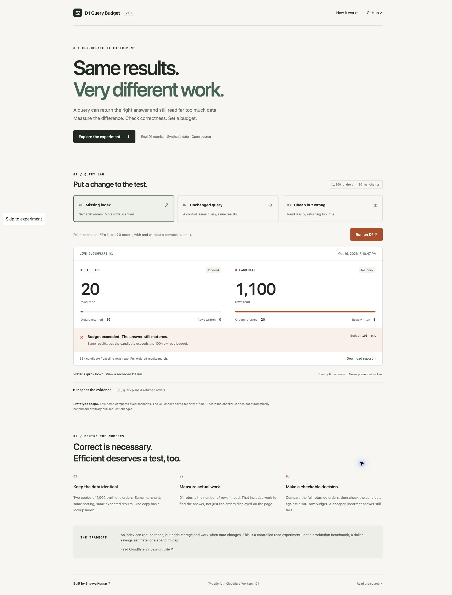

# Release verification — October 19, 2026

- Public demo: https://d1.bhavyakumar.ca
- Public source: https://github.com/Bhavya2025/d1-query-budget
- Frontend redesign published as Worker version 6e1a0366-7208-483b-93aa-14a51cce8267. Three live scenarios verified through the new UI; desktop/mobile, keyboard, recorded mode and controlled error recovery reviewed. See docs/frontend-review.md and evidence/frontend/review.json for observations and limits.
- Custom domain connected October 19, 2026. HTTPS returned 200 with successful certificate verification. A same-origin unchanged comparison passed the CLI, and a live browser missing-index run reproduced 20 versus 1,100 reads with identical results. The original workers.dev address remains enabled. Wrangler configuration includes the custom hostname; its dry-run build passed.
- First successful CI run: https://github.com/Bhavya2025/d1-query-budget/actions/runs/39324281511
- Typechecking and all 36 automated tests passed locally. CI also performs a dry-run Worker build without Cloudflare credentials.
- Three repeated remote D1 measurements reproduced 20 indexed reads versus 1,100 unindexed reads for the same 20 orders. Full-table bidirectional EXCEPT checks found no differences. Raw evidence is in evidence/.
- Live browser checks verified missing-index (budget failure), unchanged (pass), and wrong-result (correctness failure). All reported zero writes.
- The recorded-example control visibly labels the historical capture time. The mobile interface was inspected at 390 × 844, with no measured horizontal overflow; the viewport override was then reset.
- Live invalid-input requests were rejected. Automated endpoint tests additionally cover cross-origin requests, throttling, unexpected fields, bodies, methods, and provider errors.
- Report files and CLI exit codes were verified. Although the browser automation download event timed out, subsequent folder consolidation located the exported missing-index and wrong-result JSON files in Documents. Both were moved into evidence/downloads/ and passed CLI validation with their expected rejection decisions (budget-exceeded and results-changed).
- The Cloudflare dashboard showed the Free plan. No plan upgrade was performed. The rate limiter is approximate and per location, not a global quota reservation.

This release is a fixed-scenario demonstrator with a saved-report checker. It does not automatically benchmark arbitrary pull-request queries. The walkthrough is in demo-walkthrough.md.

