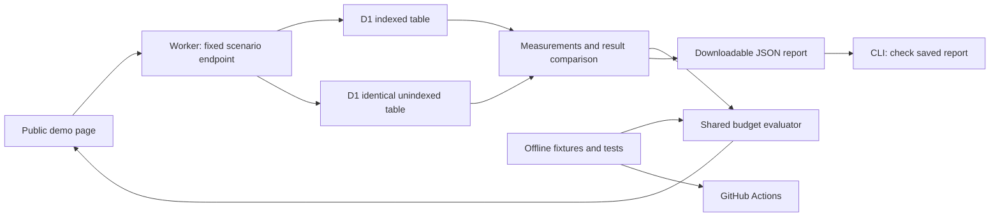

# D1 Query Budget — few-hours MVP plan

Status: approved for implementation by the user on October 19, 2026 ("start developing").

## Purpose in plain language

An ordering dashboard can display the correct 20 orders while its database quietly scans far more data than necessary. D1 Query Budget measures that difference and explains whether it exceeds a chosen testing limit. The demonstration lets a visitor see the problem, the check, and the fix.

Primary audience: developers using D1. Secondary audience: recruiters and interviewers who need to understand the work quickly. Recommendation: one small developer tool with a clear public demonstration, rather than a full SaaS dashboard.

## Success for this release

1. A public page runs fixed, read-only comparisons against real remote D1 and clearly identifies the source of its measurements.
2. Indexed and unindexed fixtures return identical results but expose a measured row-read difference. No invented numbers.
3. The checker passes a no-change comparison, rejects an over-budget comparison, and rejects an intentionally incorrect result even if cheaper.
4. A small CLI checks a captured report with the same policy used by the page. Exit codes distinguish pass, rejected comparison and invalid/error report.
5. A public GitHub repository provides reproducible setup, tests, example measured reports, limitations, and a short demo walkthrough.
6. Bhavya can explain what an index does, what the metric measures, why correctness matters, and the limits of synthetic data.

If remote execution cannot be completed, the project is not ready to claim a live D1 demo. A clearly labeled local prototype is a fallback artifact, not a replacement success claim.

## Scope

Included: one TypeScript Worker with static HTML/CSS/JS assets, one D1 database with isolated synthetic table copies, fixed scenarios, pure report evaluator, JSON download, saved-report CLI, offline tests and GitHub CI.

Deferred: arbitrary SQL, user database connections, accounts/billing, LLM suggestions, ORM integration, automatic query extraction, arbitrary PR schema comparison, automated remote CI provisioning, runtime circuit breakers, dollar forecasts, query writes/state equivalence, multi-cloud support, npm publication and a large frontend framework.

There is no need to build a restaurant app. Orders are test data that make the database problem understandable.

## Visitor experience

1. Landing message: “Same results. More database work. Catch the difference.”
2. Select a scenario: unchanged query, missing index, or incorrect result. All are predefined on the server.
3. Press “Run on D1.” Show an honest loading state.
4. Display rows returned, rows read, correctness and budget status side by side. Include a sentence explaining the outcome.
5. Expand SQL, indexes, raw query plans and measurement details. Download the report or open the source repository.

Prominent limitation on the page: this first release demonstrates fixed query comparisons and checks captured reports. Its offline CI does not execute changed SQL from arbitrary pull requests.

The missing-index scenario uses a pre-existing unindexed table. The page never actually drops an index or changes shared data. “Compare indexed version” switches to another read-only comparison, not a public migration endpoint.

Use a clean developer-tool design: neutral background, readable typography, restrained green/red status indicators with text labels, keyboard-operable controls and mobile layout. No animation or visual effect takes priority over a working remote measurement.

## Architecture

One repository, no monorepo, no database provisioning service. Use Workers bindings in the server; no Cloudflare credentials in the browser. Wrangler handles local development and deployment. Pin installed dependency versions and commit the lockfile during implementation.

Proposed code boundaries: `src/worker.ts` for fixed endpoints, `src/scenarios.ts` for SQL catalog, `src/evaluate.ts` for validation/comparison/policy, `public/` for the page, `scripts/` for deterministic seeding and saved-report checking, and `tests/` for meaningful behavior cases. These files do not exist yet.

## Dataset and measurement contract

- Begin with 1,000 synthetic orders per table, multiple merchants, deterministic ID and time values. Scale to 10,000 only if the first experiment needs it and free allowance permits.
- Both copies have identical rows and primary keys. Only the candidate's secondary index differs in the regression scenario.
- Main query filters merchant and sorts by created time plus ID, returning at most 20 rows. Freeze a known merchant with sufficient orders; no visitor-controlled query text.
- Index candidate: merchant ID, creation time, order ID. Verify the plan and actual measurements; do not assume exact savings.
- Capture query metadata separately from EXPLAIN and seed operations. Schema setup costs are not counted as SELECT costs.
- Validate both sides against fixture expectations and each other. Use stable, type-preserving result comparison. A no-op comparison must pass without special-casing its label.
- Report fields include version, scenario, dataset identity/size, source mode (`local` or `remote`), timestamp, SQL/parameters, schema variant, complete bounded result arrays for both sides, read/write counters, comparison result, policy, and policy decision. Store raw provider metadata alongside normalized fields.
- The CLI validates arrays and recomputes equality and the budget decision. It must never trust supplied correctness or decision flags. Its exit status uses the declared policy, displayed explicitly. A valid format does not cryptographically prove a D1 run; published captures are reproducible project evidence, not signed provider attestations.
- Unknown/error/cached/recorded states remain visible. A recorded report includes its original timestamp and is never described as a fresh run.
- Require finite nonnegative counters; missing metrics are errors. SELECT cases must have zero writes. A zero baseline gets explicit handling, never division by zero.
- Compare complete returned values, not only row count. Intentionally wrong results always fail. Equivalence applies only to the tested data/parameters.

## Budget rule

Keep the first release simple: one documented absolute maximum for rows read per scenario. Choose and justify it from the initial remote experiment; use the same policy across all comparisons within that scenario. Show the before/after ratio as explanatory information, not a second independently configurable rules engine.

Policy precedence: invalid/error report -> error; unequal results -> rejected; candidate exceeds configured read limit -> rejected; otherwise pass. A regression can be informational while still within budget; explain that distinction. No production billing guarantee.

Suggested CLI exit codes: 0 pass, 1 rejected, 2 invalid/incomplete/error report. Planned commands such as `npm test`, `npm run check -- report.json`, `npm run dev` and `npm run deploy` are acceptance targets, not currently available commands.

## Free-plan operation

No upgrade, payment, paid service or production database access. Inspect the account's available allowance at implementation time. Both seeding and indexes contribute to writes. Use smaller data if needed rather than spending to force a demo.

Public endpoint accepts only known scenario IDs; fixed queries and bounded results. Add server-side request throttling and clear retry/error responses. This mitigates abuse but is not a global spending cap. Start modestly and show a timestamped recorded example if live requests are throttled, clearly labeled as recorded. Never reseed or apply migrations on page visits. No secrets or personal/company data in logs or exported examples.

## Implementation steps after approval

Times below are rough effort estimates, not a guarantee; target about 3–4 hours assuming account and tools cooperate. Each step is a small commit/PR-sized unit. Keep implementation serial so Bhavya can understand each layer.

### 1. Prove the measurement (30–45 minutes)

Context: nothing has been implemented. The key risk is whether deployed D1 produces meaningful metrics for the fixed example.

Tasks: scaffold the minimal Worker, deterministic fixtures and explicit local/remote setup; verify deployment access; seed isolated tables; run indexed/unindexed queries three times and preserve raw responses. Resolve Git tooling without accepting legal terms on the user's behalf.

Verification: identical seed content and returned results; nonzero valid read counts; zero SELECT writes; correct local/remote labels; reproducible difference on remote D1. Record actual usage, tool versions and provenance.

Timebox: if authentication or tooling still blocks remote measurement after 30 minutes, report the blocker and adjust the schedule before spending time on UI. Do not accept an Xcode license for the user.

Exit: a genuine remote report with a clear difference. If this fails, fix it before any UI. Rollback: remove only new project-owned test resources, preserving captured evidence; never touch other databases.

### 2. Implement the checker (35–45 minutes; depends on 1)

Context: remote evidence establishes the shape of a valid report. Implement shared evaluation and a narrow saved-report CLI, not remote credential plumbing.

Tasks: define report validation, full bounded result comparison, a single row-read budget and exit codes. Tests must cover unchanged pass, threshold breach, wrong result, equal length/different content, empty expected results, missing counters, zero baseline, invalid data, tampered correctness/decision flags and provider error.

Verification: planned `npm test` passes; planned CLI returns 0/1/2 for the appropriate fixtures. Labels alone cannot force pass or fail. Remote report is accepted by the validator.

Exit: shared logic produces an explainable decision. Rollback: revert this unit without changing fixture data.

### 3. Build the live demo (45–60 minutes; depends on 2)

Context: the Worker can measure and the evaluator can decide; the UI must show actual behavior clearly.

Tasks: build the single page and fixed read-only scenarios; show loading/error/throttled states, before/after metrics, provenance, SQL and downloadable JSON; add a concise how-it-works explanation. Add basic server throttling without presenting it as a hard cap.

Verification: manually run all scenarios against deployed D1; confirm error handling, keyboard controls, mobile layout and report download. Verify unknown scenario IDs and unexpected SQL/parameter fields are rejected before database work, including on the deployed endpoint. Ensure public requests cannot supply SQL or perform writes; error responses expose neither stack traces nor configuration details. Check measurements in the UI match downloaded raw evidence.

Exit: a visitor can understand the problem and result in about a minute. Rollback: remove new public route/deployment only; keep local implementation and reports.

### 4. Package evidence and GitHub (30–45 minutes; depends on 3)

Context: a working demonstration exists. Now make it reproducible and honestly described.

Tasks: publish a dedicated public repository under the user's account, inspect contents for credentials, add setup instructions, architecture, limitations, one real captured report and a short screen recording or screenshot sequence. Add offline CI for tests and saved-report validation. Include a controlled expected-failure example; do not leave the default branch failing intentionally.

Verification: clean install/test instructions work; CI passes; a deliberately bad report returns exit 1; the public demo and source links work while signed out. A remote demo run is separate evidence from offline CI.

Exit: usable demo URL and repository URL, with honest evidence. Rollback: revert only the publishing/configuration changes if necessary; do not delete history or remote work casually.

### 5. Explain and prepare the résumé (15–20 minutes; depends on 4)

Context: describe only implemented and verified behavior.

Tasks: walk Bhavya through query -> database -> metadata -> correctness -> budget decision; ask him to explain each concept back. Write a résumé bullet using measured data and clearly label synthetic workloads. Link demo and GitHub from portfolio if later requested.

Verification: Bhavya can explain why fast-looking queries may read many rows, why an index has tradeoffs, why result equality matters, and why local CI is not a remote benchmark.

Exit: one honest bullet and a 60-second demo story. Do not claim customer adoption, actual money saved, Cloudflare endorsement, or automatic pre-merge integration that has not been implemented.

## Learning checkpoints

After step 1: “What are rows read versus rows returned?” After step 2: “Why must a cheap wrong query fail?” After step 3: “Where does the measurement come from?” After step 4: “What does CI actually prove?” Each checkpoint gets a short explanation, not a long lecture during the time-limited build.

## Decisions and remaining uncertainties

Confirmed: few-hours deadline, explain-as-we-build, Free plan, local Markdown tasks and AGENTS.md. Proposed: developer audience, one Worker, one synthetic dataset, three scenarios, saved-report CLI, one absolute budget.

Open for the first implementation spike: exact dataset size and threshold, Cloudflare login readiness, working Git executable, and available account allowance. No need to settle colors or branding before proving the mechanism.

Plan changes: update this document with the reason and changed acceptance criteria before adding scope. If time slips, cut extras such as elaborate charts or a recording before cutting correctness, actual D1 evidence, or clear limitations.

## Plan review

Reviewed through the Blueprint skill on October 19, 2026. Incorporated explicit result arrays and recomputation rather than trusting report flags; prominent MVP-versus-automatic-PR-check distinction; deployed invalid-input checks; and a toolchain/authentication timebox. No implementation or benchmark has occurred.

## Implementation record — October 19, 2026

Frontend follow-up authorized: improve the existing demo's visual design and usability. Scope and verification are recorded in plans/frontend-design.md; measurement logic and the three-scenario boundary stay the same.

Follow-up authorized: connect the existing Worker to d1.bhavyakumar.ca on the Free plan, preserve the existing workers.dev address, update deployment configuration and public links, and verify HTTPS plus a live comparison through the custom hostname.

User approved development. Remote D1 reproduced 20 versus 1,100 reads with identical results in three runs; retained 1,000 rows per table. Implemented the fixed 100-read policy, three scenarios, shared evaluator, saved-report CLI and public Worker UI. Free plan verified in dashboard. Published the public GitHub repository and verified passing CI. Release checks and remaining verification limits are in docs/release-verification.md. The interview walkthrough and supported résumé bullet are ready; the user's explain-back exercise remains a learning follow-up.
